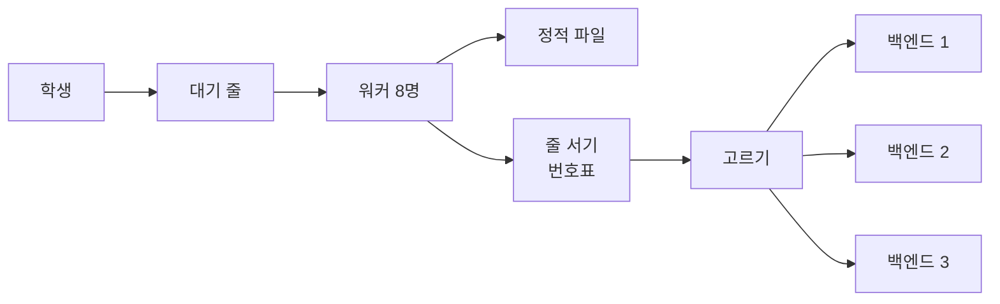

# 수강신청 시스템을 백엔드 3대로 운영하기

> C로 만든 웹 서버 + 리버스 프록시. 라이브러리 없이 소켓부터 직접 만들었습니다.
> 발표 분량: 약 3분. 자세한 근거는 [보고서](docs/report-traffic.md)에 있습니다.

## 1. 무엇이 궁금했나
리버스 프록시에 서버를 3대 붙였습니다. 그런데 **나눠 준 것과 잘 나눠 준 것은 달랐습니다.** 한 번에 한 건만 하는 서버 2대에서, 2초짜리 요청을 계속 보내는 한 명이 빠른 요청을 초당 6,000건에서 3건으로 만들었습니다.

그래서 물었습니다.

> 수강신청 시스템은 때마다 다르다. 서버 3대를 **때마다 어떻게** 나눠야 하나? 그 방법은 **언제 지나**?

## 2. 어떻게 생겼나



- **줄 서기:** 누구인지 묻지 않고 **번호표**만 준다. 누구인지는 백엔드가 판단한다
- **고르기:** 차례대로, 덜 바쁜 쪽, 아픈 서버 빼기 중 고른다. 실패 뒤에는 조회만 다시 보낸다

## 3. 때마다 무엇이 달랐나

| 때 | 잰 것 | 고른 방법 |
|---|---|---|
| 평소 | 1대와 3대의 조회가 같다 (p99 12~15ms) | 2대면 충분 |
| 준비 기간 | 차례대로는 조회가 **2초**, 덜 바쁜 쪽은 **14ms** | 덜 바쁜 쪽 |
| 신청 기간 | 처음 25~26명, 줄 8은 51명, 번호표(자리 12)는 **56~57명** | 핑구 결정 대기 |
| 도중 고장 | 처음 90%, 덜 바쁜 쪽이나 빼기는 **98%** | 덜 바쁜 쪽 + 빼기 |
| 업데이트 | 막 켜진 서버로 **몰리지 않았다** | 덜 바쁜 쪽 |
| 업데이트 실수 | 덜 바쁜 쪽 **실패 90%**, 빼기를 켜면 **0.1%** | 아픈 서버 빼기 |

**가장 놀란 것은 마지막 줄입니다.** 준비 기간에 1등이던 "덜 바쁜 쪽"이 업데이트 실수에는 꼴등이었습니다. 바로 실패하는 서버는 일이 없어 **가장 한가해 보이기** 때문입니다.

## 4. 가장 깊게 판 것: 동시에 누르면 누가 먼저인가
웹 서버는 **먼저 누른 학생을 알 수 없습니다.** 도착한 순서만 봅니다(한 줄로 처리해도 4~5%가 뒤집혔습니다). 좌석의 주인은 백엔드와 DB가 정합니다. 웹 서버가 할 수 있는 것은 **다시 눌러도 유리하지 않게** 하는 것입니다.

규칙: 번호표를 준다. 다시 와도 같은 순서다. **소식이 몇 초 없으면(유예) 떠난 것이고, 자리는 다음 사람 것이다.**

| 유예 | 성공 | 무슨 일이 |
|---|---|---|
| 1초 | 17명 | 안내대로 기다린 학생 **0%**, 계속 누른 학생 **100%**. 안내는 "1초 뒤", 유예도 1초 |
| **3초 (자리 12)** | **56~57명** | 두 학생의 차이 6~9%p |
| 10초 | 8명 | 떠난 학생을 기다리느라 자리가 논다 |

대가도 있습니다. **지하철에서 잠깐 끊긴 학생은 0%** 입니다.

## 5. 예측은 틀렸습니다
재기 전에 예측을 적고, 잰 뒤에 고치지 않았습니다.

- 저는 "차례대로가 더 실패한다"고 했지만 **덜 바쁜 쪽이 훨씬 더** 실패했다 (33% 대 90%)
- AI는 "고르게 나누면 성공 78~80%"라고 했지만 차례대로(90%)보다 **낮았다** (86%). 이유는 아직 모른다

## 6. 그래서
상황마다 좋은 방법이 다르고, **좋은 방법도 상황이 바뀌면 독이 됩니다.** 그래서 덜 바쁜 쪽은 아픈 서버 빼기 없이 쓰지 않기로 했습니다.

- **한계:** 한 컴퓨터 안의 3대이고, 요청 비율은 가정입니다. 컴퓨터가 꺼지는 것은 재지 않았습니다
- **CGI를 안 쓴 이유:** 프록시 컴퓨터에서 돌아 3대로 나눌 수 없기 때문입니다. 느려서가 아닙니다 (생성 비용 0.66~1.96ms)

[보고서](docs/report-traffic.md) · [기획서](docs/proposal-traffic.md) · [결정 기록](docs/adr) · [읽기 가이드](docs/guides)

---

# jungle_web_server

## 핑구 구현 실행 방법 (`pinggu` 브랜치)

C 웹 서버 + 리버스 프록시. 빌드와 실행은 Docker 컨테이너(Ubuntu 24.04) 안에서 합니다. Docker Desktop이 켜져 있어야 합니다.

```
git checkout pinggu
docker compose up -d --build     # 처음 한 번 (이미지 빌드 + 컨테이너 시작)
docker compose exec dev bash     # 터미널마다 하나씩 (서버 / curl / 백엔드)
docker compose down              # 끝낼 때
```

컨테이너 안 `/work`가 이 저장소입니다. 호스트(Windows · macOS)에서는 `localhost:8080`으로 접속할 수 있습니다.

컨테이너 안에서 빌드 · 실행:

```
make                    # build/server
make test               # 단위 테스트 (tests/test_*.c)
make asan               # ASan + UBSan으로 서버 · 테스트 빌드 후 테스트 실행
./build/server -c conf/server.conf      # 기본: / 는 정적 파일, /api/ 는 백엔드 8001 · 8002로 번갈아
./build/server -p 9090 -r ./www         # 인자가 설정 파일 값을 덮어씀 (-c 없으면 정적 서버만)
./build/backend 8001 & ./build/backend 8002 &    # 테스트용 백엔드 (/api/time · /api/echo · /api/slow)
tests/functional.sh                     # 기능 테스트 (서버 · 백엔드를 스스로 띄움, 종료 코드 = 실패 수)
# 종료: Ctrl+C 또는 kill -TERM → 새 연결을 막고 진행 중인 요청을 마무리한 뒤 끝남
curl -v localhost:8080/
```

빌드 · 실행 명령은 스텝이 진행되면서 여기에 추가합니다.

수강신청 데모 (백엔드 3대 + 번호표 줄 서기 + 덜 바쁜 쪽 + 아픈 서버 빼기):

```
./build/backend 8001 8 & ./build/backend 8002 8 & ./build/backend 8003 8 &
./build/server -c conf/course.conf      # 화면: http://localhost:8080/course/
tests/traffic.sh 6                      # 상황 실험 다시 재기 (1~6)
```
