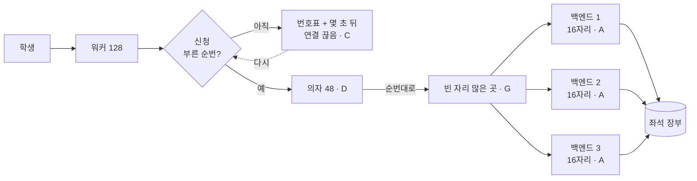

# 리버스 프록시에서 하는 트래픽 제어

> 수강신청 정각, 학생 5,000명이 동시에 누를 때
> C · POSIX 소켓으로 만든 웹 서버 + 리버스 프록시 (HTTP · 이벤트 루프 라이브러리 없음) · 숫자의 근거: [보고서](docs/report-5000.md)

**한 줄:** 웹 서버를 빠르게 만든 게 아니라, 몰릴 때 **얼마나, 누구부터, 어디로** 보낼지 정하는 트래픽 제어를 프록시에 만들었습니다.

| 이미 있는 것 | 이 프로젝트가 한 것 |
|---|---|
| 대기열 · 입장 제한 · 서버별 연결 제한 (넷퍼넬, nginx 등) | 직접 만들고, 수강신청 조건에서 **재서** 숫자로 보였다 |
| | 재다가 **예상 못 한 문제**를 찾아 원인을 밝히고 고쳤다 (3장 E · F) |

## 1. 어떤 상황
**겪은 것:** 느리다 → 됐는지 모른다 → 그래서 계속 누른다

| 조건 | 값 |
|---|---|
| 학생 | **5,000명** × 5과목 = 25,000건, 정각 첫 1초에 70% |
| 경쟁 | 인기 과목 4.5배 · 초인기 과목 10배 |
| 행동 | 얌전 68% · 계속 누름 10% · 매크로 2% · 창 3개 10% · 끊김 5% · 떠남 5% |
| 참을성 | 답이 없으면 3초 뒤 새로고침 |
| 서버 | 프록시 1대 + 백엔드 3대 + 좌석 장부(과목마다 잠금) |

경쟁 4~5배 · 매크로 · 여러 창은 기사에서 확인했고, 인원과 비율은 가정입니다. 학생 5,000명은 직접 만든 클라이언트(`client/students.c`)가 흉내 냅니다.

**목표 (재기 전에 고정):** 모두가 성공할 수는 없다. 대신 **모두가 빨리, 순서대로, 정확한 결과를 안다**

| 빨리 | 정확히 | 순서대로 | 꼼수 안 통함 | 고장에도 |
|---|---|---|---|---|
| 전원 60초 안에 결과를 앎 | 정원 초과 · 중복 0 | 먼저 왔는데 못 받은 짝 < 2% | 누름 · 매크로 · 창의 이득 < 5%p | 백엔드 1대가 죽어도 |

## 2. 왜 필요했나: 들어오는 양이 처리할 수 있는 양보다 훨씬 많다

| | 양 |
|---|---|
| 들어오는 것 | 정각 첫 1초에 학생 **3,500명** |
| 처리할 수 있는 것 | 백엔드 3대 × DB 연결 16 = 동시에 **48건** (초당 약 640건) |

로드밸런서는 **어디로** 보낼지만 정합니다. 그런데 넘치는 양은 어느 서버로 보내도 넘칩니다. 실제로 재 보니 그랬습니다.

| 로드밸런싱만 했을 때 | 결과를 안 학생 | 무슨 일이 |
|---|---|---|
| ① 3대에 차례대로 | 19.5% | 줄이 차서 거절 → 다시 누름 → **자주 누른 사람**이 이김 (매크로 100%, 얌전 14%) |
| ② 거절 대신 크게 받음 (워커 128, 줄 16,384) | **6.3%** | 서버 안에 줄이 길어짐 → 3초 뒤 새로고침 → 서버는 **떠난 학생의 옛 신청**까지 처리 (25,000건이 40,517건으로) |

→ 필요한 것은 **얼마나** 들일지와 **누구부터** 들일지였습니다.

## 3. 무엇을 고쳤나: 고칠 때마다 다음 문제가 보였다
A~D는 알려진 방법을 우리 조건에 맞춘 것이고, **E · F는 재다가 찾은 문제**입니다.

| # | 문제 | 원인 | 고친 것 | 결과 |
|---|---|---|---|---|
| A | 떠난 학생의 일까지 함 | 처리할 수 있는 것보다 많이 들임 | **백엔드마다 16건까지만** 보내고, 꽉 차면 바로 답함 (`balance.c`) | 결과를 앎 6.3% → **100%** |
| B | 빈자리를 자주 누른 사람이 가져감 | 다시 온 사람과 처음 온 사람을 구분 못 함 | **번호표**(순번 + 난수)를 쿠키로 줌. 학번이 아닌 이유: 웹 서버는 사람을 모른다 (`gate.c`) | 다시 눌러도 순번 그대로 |
| C | 기다리는 수천 명이 워커를 붙잡음 | 연결을 쥔 채 기다림 | **"몇 초 뒤에 오세요"** 라고 답하고 연결을 끊음. 3초 늦으면 다음 사람 차례 (`gate.c`) | 기다리는 동안 서버 비용 거의 0 |
| D | 자리가 비어도 놂 | 다음 사람이 밖에서 돌아올 때까지 빔 | 곧 들어갈 48명만 **의자**에서 기다리게 함. 자리가 비면 순번이 빠른 사람부터 (`gate.c`) | 38.7초에 전원 · 먼저 왔는데 못 받음 31% → **0.7%** · 매크로 76% → 20% (얌전 22%) |
| E | 창 3개가 인기 과목을 더 받음 (+3.5~6.1%p) | 과목마다 줄 끝에 다시 서서, 창이 많으면 여러 줄에 미리 섬 | 처음 번호표로 5과목을 **이어서** 신청 (`gate_keep 1`) | 창의 이득 +2.0%p. 하지만 매크로가 유리해짐 |
| F | 이어서 했더니 매크로가 유리 | 번호표 1장 = 5건인데 1건으로 보고 **너무 많이 부름**. 원인 추측 1개는 틀려서 되돌림 | 부른 사람이 못 앉으면 **부르기를 잠깐 멈춤** (`gate.c`) | 창의 이득 **0~0.6%p** · 요청 수 절반 |
| G | 백엔드 1대가 죽음 | 남은 2대에 48건을 몰면 A로 돌아감 | 3번 이어서 실패하면 10초 빼고 **자리도 48 → 32**로 줄임 (`balance.c`) | 전원 **55.7초**, 됐는데 모름 0 |

정원 초과와 중복은 프록시가 아니라 **좌석 장부**(`backend/ledger.c`)가 막습니다. 신청은 실패해도 프록시가 다시 보내지 않습니다(이미 처리됐을 수 있으니까요).



### 남은 선택: "먼저"는 누구인가
E와 F를 고친 뒤에도 "먼저 왔는데 못 받은 짝"이 5~7%로 남았습니다. 들여다보니 버그가 아니라 "먼저"의 뜻이 두 가지였습니다.

| 인기 2과목 (학생 구성을 바꿔 3번 잰 범위) | 줄 끝부터 | 이어서 (선택) |
|---|---|---|
| 창 3개의 이득 | +3.5~6.1%p | **0~0.6%p** |
| 매크로 − 얌전 | −3~+7%p | −4~+4%p |
| 그 과목을 먼저 **누른** 순서와 어긋남 | **0.3~0.5%** | 4.8~7.0% |
| 사이트에 먼저 **온** 순서와 어긋남 | 2.3~3.7% | **1.6~2.6%** |
| 절반이 끝난 시각 | 32.3~32.8초 | **19.2~19.5초** |
| 5초 끊긴 학생의 인기 과목 성공 | **0.9~4.1%** | 0.2~1.0% |

측정으로 정할 수 없는, **무엇을 공정이라 부를지의 선택**이었습니다. 먼저 **온** 사람을 골랐습니다.

## 4. 결과

| 단계 | 60초 안에 결과를 앎 | 마지막 학생 | 먼저 왔는데 못 받음 | 매크로 / 얌전 |
|---|---|---|---|---|
| ① 차례대로 | 19.5% | - | 27.1% | 100% / 14% |
| ② 크게 받음 | 6.3% | - | (멈춤) | 12% / 22% |
| + A | 100% | 52.1초 | 31.0% | 76% / 17% |
| + B · C · D | 100% | 38.7초 | 0.7% | 20% / 22% |
| + E · F (최종) | **100%** | **38.3~38.5초** (계산 39초) | **0.6~0.9%** | **19~26% / 22%** |

정원 초과 · 중복은 모든 단계에서 0입니다. 최종 행은 학생 구성을 바꿔 3번 잰 범위입니다.

**38초는 한 사람이 걸린 시간이 아닙니다.** 5,000명 중 **마지막 학생**이 5과목을 다 끝낸 시각입니다.
- 학생 절반은 약 **19초 기다린 뒤**, 들어가면 5과목을 **0.6초 안에** 끝냅니다 (신청 1건 처리 p50 84ms)
- 기다림은 프록시가 아니라 **백엔드 용량** 때문입니다: 25,000건 ÷ 초당 640건 = 39초. 백엔드가 2배면 약 20초입니다 [계산]
- 프록시가 하는 일은 기다림을 없애는 것이 아니라, 기다림을 **순서대로, 보이게**(앞에 몇 명, 몇 초 뒤) 만드는 것입니다

**예상은 셋 다 틀리거나 반만 맞았습니다** (재기 전에 적고 고치지 않음)

| 가설 | 예상 | 결과 |
|---|---|---|
| 줄 끝부터는 창 여러 개에 유리 | +10%p 이상 | 인기 1과목 +0.4%p · 2과목 +3.5~6.1%p (3번 모두 유리, 10%p에는 못 미침) |
| 많이 부르면(200%) | 의자가 넘쳐 느려짐 | 속도는 비슷, **순서**가 깨짐 |
| 초인기 과목이 남을 막음 | 잠금 10ms부터 | 10ms는 괜찮고 20ms에서 +5.6초 |

## 5. 대가와 한계

| 선택 | 잃은 것 |
|---|---|
| 번호표 | 창마다 받을 수 있음 (이득만 없앰) |
| 3초 유예 | 5초 끊긴 학생의 성공률 1~7% |
| 의자 48 | 워커 48명이 묶임 |
| 이어서 | 과목을 먼저 누른 순서 |

**해 봤지만 뺀 것**

| 방법 | 결과 | 뺀 이유 |
|---|---|---|
| 과목별 자리 제한 (한 과목이 16자리까지) | 잠금 5ms 차이 없음 · 20ms에서 1.6초 빨라짐 | 이 조건에서는 효과가 작다 |
| 마감 기억 (마감 답을 1초 동안 프록시가 대신) | 마지막 학생 38.7 → 35.0초 (1번 잼) | 이미 신청된 학생 4명에게 **"마감"이라는 틀린 답** |

**다음에 재 볼 것:** 5과목을 한 번에 보내는 일괄 신청. E · F 고민은 사라지지만, 마감되면 바로 다른 과목으로 바꿀 수 없다

**한계**
- 컴퓨터 1대, DB는 흉내, 학생 비율은 가정
- 공정성 핵심(E · F)과 최종 설정은 학생 구성을 바꿔 3번, 나머지 실험은 대부분 1번 잼. 매크로는 200명 안팎이라 ±4%p는 우연과 구분되지 않음
- 프록시가 죽으면 번호표가 사라짐

[보고서](docs/report-5000.md) · [앞 단계: 상황별 로드 밸런싱](docs/report-traffic.md) · [결정 기록](docs/adr) · [읽기 가이드](docs/guides)

---

# jungle_web_server

## 핑구 구현 실행 방법 (`pinggu` 브랜치)

C 웹 서버 + 리버스 프록시. 빌드와 실행은 Docker 컨테이너(Ubuntu 24.04) 안에서 합니다. Docker Desktop이 켜져 있어야 합니다.

```
git checkout pinggu
docker compose up -d --build     # 처음 한 번 (이미지 빌드 + 컨테이너 시작)
docker compose exec dev bash     # 터미널마다 하나씩 (서버 / curl / 백엔드)
docker compose down              # 끝낼 때
```

컨테이너 안 `/work`가 이 저장소입니다. 호스트(Windows · macOS)에서는 `localhost:8080`으로 접속할 수 있습니다.

컨테이너 안에서 빌드 · 실행:

```
make                    # build/server
make test               # 단위 테스트 (tests/test_*.c)
make asan               # ASan + UBSan으로 서버 · 테스트 빌드 후 테스트 실행
./build/server -c conf/server.conf      # 기본: / 는 정적 파일, /api/ 는 백엔드 8001 · 8002로 번갈아
./build/server -p 9090 -r ./www         # 인자가 설정 파일 값을 덮어씀 (-c 없으면 정적 서버만)
./build/backend 8001 & ./build/backend 8002 &    # 테스트용 백엔드 (/api/time · /api/echo · /api/slow)
tests/functional.sh                     # 기능 테스트 (서버 · 백엔드를 스스로 띄움, 종료 코드 = 실패 수)
# 종료: Ctrl+C 또는 kill -TERM → 새 연결을 막고 진행 중인 요청을 마무리한 뒤 끝남
curl -v localhost:8080/
```

빌드 · 실행 명령은 스텝이 진행되면서 여기에 추가합니다.

5,000명 수강신청 다시 재기 (서버, 백엔드, 학생을 스스로 띄움):

```
tests/students.sh gate                  # 한 번 (약 45초). first · wide · slots · gate
tests/experiments.sh > /tmp/x.txt 2>&1  # 사다리 + 세 실험 전부 (약 20분)
```

브라우저로 보기 (번호표 줄 서기 + 덜 바쁜 쪽 + 아픈 서버 빼기):

```
./build/backend 8001 8 & ./build/backend 8002 8 & ./build/backend 8003 8 &
./build/server -c conf/course.conf      # 화면: http://localhost:8080/course/
```
