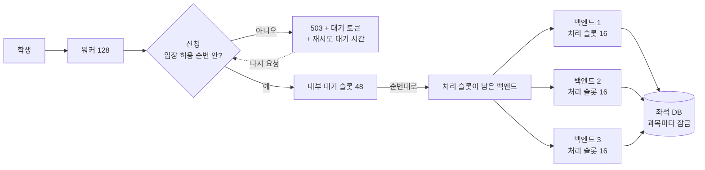

# 리버스 프록시에서 하는 트래픽 제어

> 수강신청 정각, 학생 5,000명이 동시에 누를 때 **무너지지 않고, 온 순서대로** 들여보내는 웹 서버
>
> C · POSIX 소켓으로 직접 구현 (HTTP · 이벤트 루프 라이브러리 없음) · 측정 근거: [보고서](docs/report-5000.md)

## 1. 목적

수강신청 날 겪은 것: **느리다 → 됐는지 모른다 → 그래서 계속 누른다**

정원 100명인 과목에 1,000명이 오면 900명은 어떤 서버에서도 실패합니다. 그래서 이 서버의 목표는 "더 많이, 더 빠르게"가 아닙니다.

> **모두가 빨리, 순서대로, 정확한 결과를 안다**

| 목표 | 기준 (재기 전에 고정) | 결과 |
|---|---|---|
| 빨리 | 전원이 60초 안에 5과목의 결과를 앎 | 100% · 마지막 학생 38초 |
| 정확히 | 정원 초과 · 중복 신청 0 | 0 |
| 순서대로 | 먼저 왔는데 못 받은 쌍 2% 미만 | 0.6~0.9% (인기 과목 1개 조건. 2개면 "먼저"의 기준에 따라 다름: 4장) |
| 꼼수 차단 | 일반 학생 대비 인기 과목 성공률 차이 5%p 미만 | 창 3개 0~0.6%p · 매크로 −4~+4%p (방향 일정하지 않음) |
| 고장 대응 | 백엔드 1대가 죽어도 "빨리"와 "정확히" | 전원 56초 · 초과 0 |

## 2. 조건이 설계를 정했다

| | 수강신청 정각 |
|---|---|
| 들어오는 양 | 첫 1초에 학생 **3,500명** 도착 → 각자 화면 3 · 조회 1 · **첫 신청 1건** (나머지 4과목은 결과를 받은 뒤 차례로. 신청은 모두 25,000건) |
| 처리할 수 있는 양 | 동시에 **48건** (백엔드 3대 × DB 연결 16) ÷ 건당 평균 0.075초 = **초당 640건** |
| 사용자 | 연타 · 매크로 · 창 여러 개가 섞여 있고, 응답이 없으면 3초 뒤 새로고침 |

보통의 웹 서버에는 필요 없는 것들을, 이 조건 때문에 넣었습니다. 넣은 것마다 대가가 있습니다.

| 수강신청의 조건 | 대기열 없는 프록시 (기본 구현) | 이 서버의 선택 | 대가 |
|---|---|---|---|
| 요청이 처리량을 크게 넘는다 | ② 큐에 쌓아 전부 처리 → 새로고침으로 **버려진 요청**까지 처리. 결과를 안 학생 6.3% | **입장 제어**: 백엔드당 처리 슬롯 16개, 넘치면 즉시 503 | 조금만 넘쳐도 재시도 왕복이 생김 |
| 자리가 모자라 **순서가 결과를 정한다** | ③ 순서를 기억하지 않음 → 자주 요청한 쪽이 이김 (매크로 76%, 일반 17%) | **대기열**: 대기 토큰(순번 + 난수)으로 온 순서를 기억 | 프록시가 죽으면 순번이 사라짐 · 프록시를 여러 대로 늘릴 수 없음 |
| 수천 명이 동시에 기다린다 | 연결을 유지한 채 대기 → 워커를 점유 | 503 + **재시도 대기 시간**을 주고 연결을 닫음. 곧 입장할 48건만 연결을 유지 | 3초 넘게 늦으면 순번 만료 (5초 끊긴 학생의 인기 과목 성공 1~7%) |
| 한 학생이 5과목을 연달아 신청한다 | 요청마다 따로 처리 | **토큰 유지**: 첫 순번으로 5과목 | 과목을 먼저 누른 순서는 덜 지켜짐 |
| 프록시는 사용자를 모른다 (식별은 백엔드의 일) | - | 학번 대신 **익명 토큰** | 창마다 토큰을 받을 수 있음. 막지 못하고 이득만 없앰 |
| 백엔드가 죽을 수 있다 | 남은 서버에 전부 보냄 | 실패한 서버 제외 + 처리 슬롯도 48 → 32 | 고장 동안 느려짐 (38초 → 56초) |

**그래서 이런 서비스에는 맞지 않습니다** (재지 않은 예측)
- 요청이 고르게 오는 서비스 → 대기열이 늘 비어 있어 쓸 일이 없다
- 모두 성공하는 요청 → 순서가 필요 없다. 이 서버도 화면 · 조회는 대기열 없이 바로 보낸다
- 처리 시간이 들쭉날쭉한 서비스 → 재시도 대기 시간 계산이 틀린다
- 사용자가 쉽게 떠나는 서비스(쇼핑) → 503이 곧 이탈이다

## 3. 구조



| 질문 | 담당 | 파일 |
|---|---|---|
| **얼마나** 들일까 (입장 제어) | 백엔드당 처리 슬롯 | `server/balance.c` |
| **누구부터** 들일까 (대기열) | 대기 토큰 · 입장 허용 순번 · 내부 대기 슬롯 | `server/gate.c` |
| **어디로** 보낼까 (로드 밸런싱) | 처리 슬롯이 남은 백엔드, 실패한 서버 제외 | `server/balance.c` |
| 정원 · 중복 | 좌석 DB (공유 메모리로 흉내) | `backend/ledger.c` |
| 학생 5,000명 | 측정용 클라이언트 | `client/students.c` |

## 4. 고민한 과정

한 번에 설계하지 못했습니다. 고칠 때마다 같은 5,000명으로 다시 쟀고, 다음 문제가 보였습니다.

| 단계 | 결과를 안 학생 | 마지막 학생 | 순서 어긋남 | 배운 것 |
|---|---|---|---|---|
| ① 라운드 로빈 | 19.5% | - | 27.1% | 로드 밸런싱만으로는 부족하다 |
| ② 큐 · 워커를 크게 | **6.3%** | - | - | 많이 받으면 버려진 요청을 처리한다 (25,000건 → 40,517건) |
| ③ + 처리 슬롯 | 100% | 52.1초 | 31.0% | 무너지지는 않지만 연타가 이긴다 |
| ④ + 대기열 | 100% | 38.7초 | 0.7% | 계산한 39초와 맞았다 |
| ⑤ + 토큰 유지 | **100%** | **38초** | **0.6~0.9%** | 아래 |

38초는 **마지막 학생** 기준입니다. 절반은 19초를 기다린 뒤 5과목을 0.6초 안에 끝냅니다. 대기 시간은 백엔드 처리량이 정하고(25,000건 ÷ 초당 640건 = 39초), 프록시는 그 대기를 **순서대로, 보이게** 만듭니다.

### 가장 오래 고민한 것: 공정하려던 규칙이 꼼수를 도왔다


고친 뒤에도 순서 어긋남이 남았습니다. 버그가 아니라 **"먼저"의 뜻이 두 가지**였습니다.

| 인기 과목 2개를 노릴 때 (3번 잰 범위) | 토큰 재발급 | 토큰 유지 (선택) |
|---|---|---|
| 창 3개의 이득 | +3.5~6.1%p | **0~0.6%p** |
| 그 과목을 먼저 **누른** 순서와 어긋남 | **0.3~0.5%** | 4.8~7.0% |
| 사이트에 먼저 **온** 순서와 어긋남 | 2.3~3.7% | **1.6~2.6%** |
| 절반이 끝난 시각 | 32초 | **19초** |

측정으로 정할 수 없는, **무엇을 공정이라 부를지의 선택**이었습니다. 먼저 **온** 사람을 골랐습니다.

## 5. 더 보기

<details>
<summary>용어</summary>

| 용어 | 뜻 |
|---|---|
| 처리 슬롯 | 백엔드에 동시에 보내는 신청 수의 상한 (백엔드당 16, 모두 48) |
| 대기 토큰 | 처음 신청할 때 쿠키로 주는 값. 순번(8자) + 난수(24자) |
| 입장 허용 순번 | 이 순번까지는 들어와도 된다는 경계. 처리 속도에 맞춰 올라간다 |
| 내부 대기 슬롯 | 입장 허용된 요청이 연결을 유지한 채 처리 슬롯을 기다리는 칸 (48) |
| 재시도 대기 시간 | 입장 허용 전인 요청에 주는 "이만큼 뒤에 다시" (`Retry-After`, `X-Wait-Ms`). 앞의 순번 수 ÷ 입장 허용 속도, 0.2~10초 |
| 재방문 유효 시간 | 재시도 대기 시간이 끝난 시각부터 3초 안에 같은 토큰으로 오면 순번 유지. 일찍 오면 순번은 그대로 두고 대기 시간만 다시 줌. 늦으면 새 순번(대기열 끝) |
| 워커 · 슬롯 | 워커 128 = 프록시 스레드(화면 · 조회 · 503 응답 포함 모든 요청). 신청은 처리 슬롯 48 + 내부 대기 슬롯 48로 워커를 최대 96개 씀 |
| 버려진 요청 | 학생이 새로고침해 떠났는데도 서버가 계속 처리하는 요청 |
| 순서 어긋남 | 인기 과목마다 (받은 학생, 못 받은 학생) 쌍 중 못 받은 쪽이 먼저였던 비율. "먼저"는 그 과목을 처음 누른 시각(기본) 또는 사이트에 처음 온 시각 |

</details>

<details>
<summary>측정 조건</summary>

| 조건 | 값 | 근거 |
|---|---|---|
| 학생 | 5,000명 × 5과목, 첫 1초에 70% | 가정 |
| 경쟁 | 인기 과목 4.5배 · 초인기 과목 10배 | 4~5배: 기사 · 10배: 가정 |
| 행동 | 일반 68% · 연타 10% · 매크로 2% · 창 3개 10% · 끊김 5% · 떠남 5% | 매크로 · 여러 창: 기사 · 비율: 가정 |
| 신청 1건 | 약 0.075초, 같은 과목은 한 명씩 | 가정 (DB 흉내) |

서버, 백엔드 3대, 학생 클라이언트가 2코어 컨테이너 하나에서 돕니다.

</details>

<details>
<summary>숫자의 종류: 잰 값 · 계산 · 가정</summary>

| 종류 | 예 |
|---|---|
| 잰 값 (`tests/students.sh`, 실제 코드에 흉내 낸 부하) | 결과를 안 학생 %, 마지막 학생 시각, 순서 어긋남, 매크로 · 창 성공률, 버려진 요청 40,517건, 백엔드 고장 55.7초 |
| 계산 | 처리 슬롯 16 · 초당 640건 · 39초 · "백엔드 2배면 20초" · 잠금 문턱 7.8ms |
| 가정 | 학생 수 · 도착 모양 · 행동 비율 · 건당 0.075초 · DB 연결 16 |
| 다른 설정에서 잰 값 | 대기열 v1의 "처리 슬롯 240개에 초당 153건" (앞 단계 보고서) |

</details>

<details>
<summary>예상과 결과 (재기 전에 적고 고치지 않음)</summary>

| 가설 | 예상 | 결과 |
|---|---|---|
| 토큰 재발급은 창 여러 개에 유리 | +10%p 이상 | 인기 1과목 +0.4%p · 2과목 +3.5~6.1%p |
| 입장 허용 속도를 처리량의 200%로 | 내부 대기 슬롯이 넘쳐 느려짐 | 속도는 비슷, 순서가 깨짐 (0.7% → 2.4%) |
| 초인기 과목의 잠금이 다른 과목을 막음 | 잠금 10ms부터 | 10ms는 괜찮고 20ms에서 +5.6초 |

</details>

<details>
<summary>해 봤지만 뺀 것 · 다음에 재 볼 것</summary>

| 방법 | 결과 | 뺀 이유 |
|---|---|---|
| 과목별 처리 슬롯 제한 | 잠금 20ms에서 1.6초 빨라짐 | 이 조건에서는 효과가 작다 |
| 마감 응답 캐시 (409를 1초 동안 프록시가 대신 응답) | 마지막 학생 38.7 → 35.0초 (1번 잼) | 이미 신청된 학생 4명에게 "마감"이라는 틀린 응답 |

다음에 재 볼 것: 5과목을 한 요청으로 보내는 일괄 신청, 수강신청이 아닌 트래픽(고르게 오는 요청)에서의 비용

</details>

<details>
<summary>한계</summary>

- 컴퓨터 1대에서 쟀고, DB는 대기와 잠금으로 흉내 냈습니다. 학생 비율은 가정입니다
- 좌석 DB는 한 컴퓨터의 공유 메모리와 프로세스 간 잠금입니다. 실제 DB의 네트워크 지연, 복제, 디스크 기록(영속성)이 없습니다. "정원 초과 0"은 이 잠금이 보장한 것입니다
- 공정성 실험과 최종 설정은 학생 구성을 바꿔 3번, 나머지 실험은 대부분 1번 쟀습니다
- 매크로는 200명 안팎이라 ±4%p는 우연과 구분되지 않습니다
- 대기열과 입장 제어 자체는 이미 있는 방법입니다(넷퍼넬, nginx `max_conns` 등). 이 프로젝트가 한 것은 직접 만들어 이 조건에서 재고, 재다가 찾은 문제(4장)를 고친 것입니다

</details>

[보고서](docs/report-5000.md) · [앞 단계: 상황별 로드 밸런싱](docs/report-traffic.md) · [결정 기록](docs/adr) · [읽기 가이드](docs/guides)

---

# jungle_web_server

## 핑구 구현 실행 방법 (`pinggu` 브랜치)

C 웹 서버 + 리버스 프록시. 빌드와 실행은 Docker 컨테이너(Ubuntu 24.04) 안에서 합니다. Docker Desktop이 켜져 있어야 합니다.

```
git checkout pinggu
docker compose up -d --build     # 처음 한 번 (이미지 빌드 + 컨테이너 시작)
docker compose exec dev bash     # 터미널마다 하나씩 (서버 / curl / 백엔드)
docker compose down              # 끝낼 때
```

컨테이너 안 `/work`가 이 저장소입니다. 호스트(Windows · macOS)에서는 `localhost:8080`으로 접속할 수 있습니다.

컨테이너 안에서 빌드 · 실행:

```
make                    # build/server
make test               # 단위 테스트 (tests/test_*.c)
make asan               # ASan + UBSan으로 서버 · 테스트 빌드 후 테스트 실행
./build/server -c conf/server.conf      # 기본: / 는 정적 파일, /api/ 는 백엔드 8001 · 8002로 번갈아
./build/server -p 9090 -r ./www         # 인자가 설정 파일 값을 덮어씀 (-c 없으면 정적 서버만)
./build/backend 8001 & ./build/backend 8002 &    # 테스트용 백엔드 (/api/time · /api/echo · /api/slow)
tests/functional.sh                     # 기능 테스트 (서버 · 백엔드를 스스로 띄움, 종료 코드 = 실패 수)
# 종료: Ctrl+C 또는 kill -TERM → 새 연결을 막고 진행 중인 요청을 마무리한 뒤 끝남
curl -v localhost:8080/
```

빌드 · 실행 명령은 스텝이 진행되면서 여기에 추가합니다.

5,000명 수강신청 다시 재기 (서버, 백엔드, 학생을 스스로 띄움):

```
tests/students.sh gate                  # 한 번 (약 45초). first · wide · slots · gate
tests/experiments.sh > /tmp/x.txt 2>&1  # 사다리 + 세 실험 전부 (약 20분)
```

브라우저로 보기 (대기열 + 처리 슬롯이 남은 백엔드 + 실패한 백엔드 제외):

```
./build/backend 8001 8 & ./build/backend 8002 8 & ./build/backend 8003 8 &
./build/server -c conf/course.conf      # 화면: http://localhost:8080/course/
```
