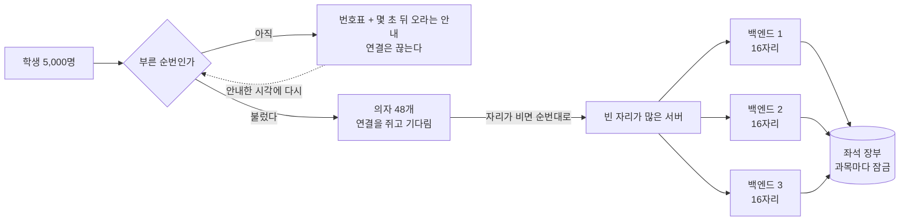
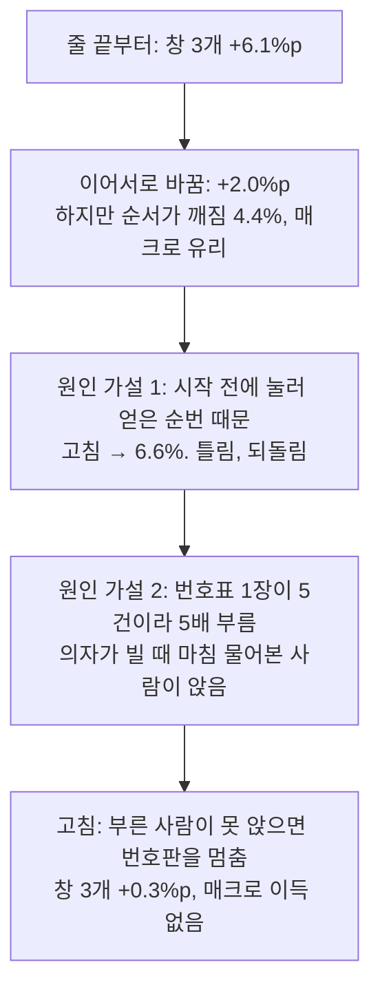

# 5,000명이 동시에 누르는 수강신청 서버

> C로 만든 웹 서버 + 리버스 프록시. 라이브러리 없이 소켓부터 직접 만들었습니다.
> 발표 약 3분. 표와 근거는 [보고서](docs/report-5000.md)에 있습니다.

**한 줄 결론:** 정원이 정해진 수강신청에서 좋은 서버는 모두를 성공시키는 서버가 아니라, **모두가 빨리, 순서대로, 정확한 결과를 아는 서버**입니다.

## 1. 왜 만들었나
수강신청은 느렸고, 됐는지 알 수 없었고, 그래서 계속 눌렀습니다. 궁금했습니다. **수강신청 서버는 어떻게 만들어야 할까?** 처음에는 서버 3대에 차례대로 나눠 주면 될 줄 알았습니다.

## 2. 구현: 5,000명이 동시에 온다
실제 수강신청 기사와 학교 안내를 보고 조건을 정했습니다. 정각에 70%가 1초 안에 몰리고, 인기 과목은 정원의 4.5배, 초인기 과목은 10배입니다. 학생마다 5과목, 모두 25,000건입니다. 계속 누르는 학생, 매크로, 창 3개, 끊김, 중간에 떠나는 학생도 섞었습니다.



계산부터 했습니다. 한 건이 0.075초이고 1대가 죽어도 60초 안에 끝내려면 한 대에 16자리입니다. **48명만 동시에 처리하면 되고, 나머지는 싸게, 순서대로 기다리면 됩니다.** 계산은 39초, 실제는 38.7초였습니다.

| 단계 | 60초 안에 5과목 결과를 다 안 학생 | 마지막 학생 | 먼저 왔는데 못 받은 짝 | 매크로 / 얌전한 학생의 인기 과목 성공 |
|---|---|---|---|---|
| ① 처음 (차례대로) | 19.5% | - | 27.1% | 100% / 14% |
| ② 워커와 줄만 늘림 | **6.3%** | - | 0.0% | 12% / 22% |
| ③ 서버마다 자리 16 | 100% | 52.1초 | 31.0% | **76% / 17%** |
| ④ 번호판과 의자 | **100%** | **38.7초** | **0.7%** | **20% / 22%** |

정원 초과와 중복 신청은 모든 단계에서 0건입니다. 서버 한 대를 도중에 죽여도 ④는 전원이 55.6초 안에 결과를 알았고, "됐는데 모름"은 0건이었습니다.

## 3. 검증: 재기 전에 예상을 적었다
| 가설 | 예상 | 결과 |
|---|---|---|
| **공정성.** "다음 과목은 줄 끝부터"는 창 여러 개에 유리한가 | 인기 과목 이득 10%p 이상 | 인기 1과목이면 **0%p**. 인기 2과목이면 10.2 → 16.3% (**+6.1%p**) |
| **초과예약.** 안 오는 학생만큼 더 부르면 빠른가 | 30%가 안 올 때 150%가 최고, 200%는 의자가 넘침 | 150%와 200%가 **비슷**. 200%의 대가는 넘침이 아니라 **순서** (0.7 → 2.4%) |
| **잠금 경합.** 초인기 과목이 다른 과목을 막는가 | 잠금 10ms부터 막힌다 (계산 7.8ms) | 10ms에서 **안 막혔다**. 20ms에서야 계산보다 5.6초 늦음. 과목별 제한은 1.6초만 되찾음 |

## 4. 발견: 예상이 틀린 곳에서 배운 것
**발견 1. 크게 만들수록 무너졌습니다.** 워커와 줄을 늘리자 결과를 안 학생이 19.5%에서 6.3%로 줄었습니다. 3초를 못 기다려 새로고침한 학생의 **옛 신청까지 서버가 계속 처리**했기 때문입니다. 신청은 25,000건인데 서버는 40,517건을 했고, 1,890건은 **됐는데 학생이 몰랐습니다.**

**발견 2. 공정하려고 만든 규칙이 창 여러 개를 이롭게 했습니다.** 그래서 순번을 유지하는 "이어서"로 바꿨고, 여기서 두 번 틀렸습니다.



고치고 다시 재니 창 3개의 이득은 **+6.1%p → +0.3%p**, 매크로의 이득은 사라졌고, 요청 수는 절반이 됐습니다. 그런데 순서(7.0%)는 예상과 달리 낫지 않았습니다. 들여다보니 **"먼저"의 뜻이 두 가지**였습니다.

| 인기 2과목일 때 | 줄 끝부터 | 이어서 (고친 뒤) |
|---|---|---|
| 창 3개의 이득 | **+6.1%p** | **+0.3%p** |
| 그 과목을 먼저 **누른** 순서와 다른 짝 | **0.3%** | 7.0% |
| 사이트에 먼저 **온** 순서와 다른 짝 | 3.5% | **2.6%** |
| 절반이 5과목을 끝낸 시각 (마지막은 둘 다 38초) | 32.3초 | **19.2초** |
| 5초 끊긴 학생의 인기 과목 성공 | **3.0%** | 1.0% |


**발견 3. 안내한 시각은 정확히 맞지 않습니다.** 안 오는 학생이 5%뿐일 때도 처리하는 만큼만(100%) 부르면 150%보다 느렸습니다(39.5초 대 38.3초). 더 부르는 것은 안 온 사람이 아니라 **늦게 도착하는 시간**을 메우는 일로 보입니다 [추정].

## 5. 선택과 한계
어느 쪽도 다 이기지 못합니다. **"먼저 누른 사람"이 공정이면 줄 끝부터, "창을 늘려도 소용없음"이 공정이면 이어서**입니다. 지금 기본값은 줄 끝부터입니다.


- **웹 서버는 누구인지 모릅니다.** 번호표만 봅니다. 그래서 창 여러 개를 완전히 막을 수 없습니다. 사람을 아는 것은 백엔드입니다
- **한계:** 한 컴퓨터 안에서 쟀고, DB는 sleep과 잠금으로 흉내 냈습니다. 학생 비율은 가정입니다. 실험은 대부분 1번, 사다리 앞 세 단계는 2~3번 쟀습니다. 작은 차이(2%p 안팎)는 우연일 수 있습니다

[보고서](docs/report-5000.md) · [앞 단계 보고서(상황별 로드 밸런싱)](docs/report-traffic.md) · [결정 기록](docs/adr) · [읽기 가이드](docs/guides)

---

# jungle_web_server

## 핑구 구현 실행 방법 (`pinggu` 브랜치)

C 웹 서버 + 리버스 프록시. 빌드와 실행은 Docker 컨테이너(Ubuntu 24.04) 안에서 합니다. Docker Desktop이 켜져 있어야 합니다.

```
git checkout pinggu
docker compose up -d --build     # 처음 한 번 (이미지 빌드 + 컨테이너 시작)
docker compose exec dev bash     # 터미널마다 하나씩 (서버 / curl / 백엔드)
docker compose down              # 끝낼 때
```

컨테이너 안 `/work`가 이 저장소입니다. 호스트(Windows · macOS)에서는 `localhost:8080`으로 접속할 수 있습니다.

컨테이너 안에서 빌드 · 실행:

```
make                    # build/server
make test               # 단위 테스트 (tests/test_*.c)
make asan               # ASan + UBSan으로 서버 · 테스트 빌드 후 테스트 실행
./build/server -c conf/server.conf      # 기본: / 는 정적 파일, /api/ 는 백엔드 8001 · 8002로 번갈아
./build/server -p 9090 -r ./www         # 인자가 설정 파일 값을 덮어씀 (-c 없으면 정적 서버만)
./build/backend 8001 & ./build/backend 8002 &    # 테스트용 백엔드 (/api/time · /api/echo · /api/slow)
tests/functional.sh                     # 기능 테스트 (서버 · 백엔드를 스스로 띄움, 종료 코드 = 실패 수)
# 종료: Ctrl+C 또는 kill -TERM → 새 연결을 막고 진행 중인 요청을 마무리한 뒤 끝남
curl -v localhost:8080/
```

빌드 · 실행 명령은 스텝이 진행되면서 여기에 추가합니다.

5,000명 수강신청 다시 재기 (서버, 백엔드, 학생을 스스로 띄움):

```
tests/students.sh gate                  # 한 번 (약 45초). first · wide · slots · gate
tests/experiments.sh > /tmp/x.txt 2>&1  # 사다리 + 세 실험 전부 (약 20분)
```

브라우저로 보기 (번호표 줄 서기 + 덜 바쁜 쪽 + 아픈 서버 빼기):

```
./build/backend 8001 8 & ./build/backend 8002 8 & ./build/backend 8003 8 &
./build/server -c conf/course.conf      # 화면: http://localhost:8080/course/
```
